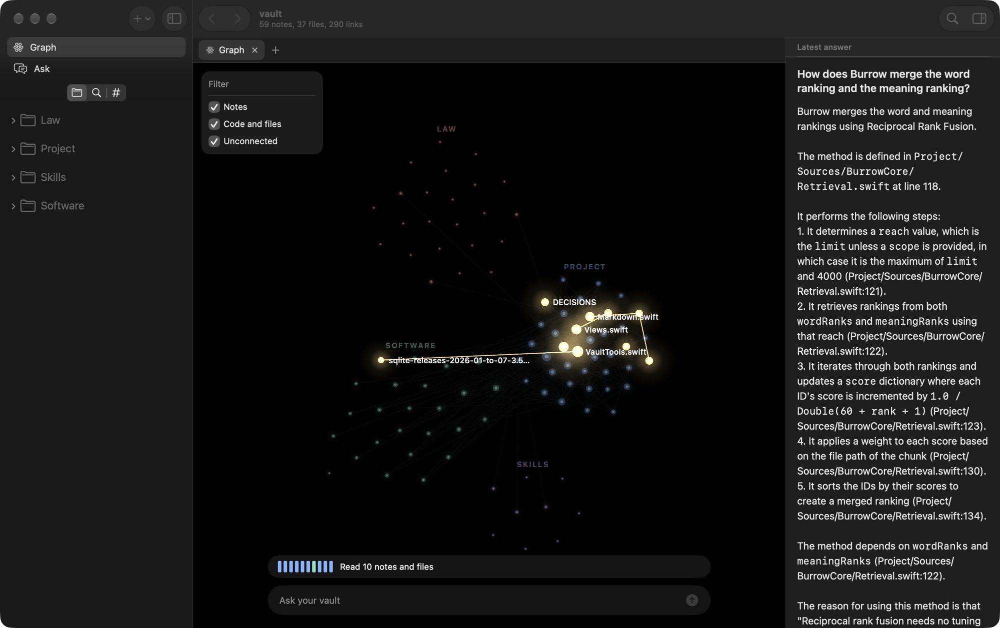

<div align="center">

# Burrow

**One memory on your Mac that every AI you use shares.**

Your notes, documents and code, and every decision you made with an AI and why,<br>
read by local and cloud models alike. Nothing you keep leaves your Mac.

[](https://github.com/Satasdin/Burrow/releases/latest)
[](https://github.com/Satasdin/Burrow/actions/workflows/tests.yml)


[Website](https://satasdin.github.io/Burrow/) · [Download](https://satasdin.github.io/Burrow/download.html) · [Docs](docs/README.md) · [Skills for agents](skills/README.md) · [BURROW.md](BURROW.md)

<br>



</div>

## Why Burrow

Every AI starts a session knowing nothing about you. A local model doesn't know your notes, and what you settle with
one model never reaches the next.

- **It replaces pasting context into every chat.** A model on your Mac answers from your own notes, documents and
  code and cites the file and line. Gemma 4 12B answered 9 of 120 questions about private material alone, and 102
  with Burrow.
- **It replaces decisions lost between sessions.** When you settle something, your AI keeps it in the **Ledger** with
  its reason and what was turned down, and every model that connects is handed it. Once reasons were kept, Claude
  Code kept an earlier decision in 9 of 9 sessions.
- **It replaces starting over in a new program.** Any program that speaks MCP picks up where the last one stopped:
  Claude Code, OpenCode, OpenClaw, Hermes Agent, n8n, LM Studio, Ollama or llama.cpp.
- **It checks before "done".** A model can read a decision and still break it, so Burrow checks each code change
  against the decisions it touches, in the agent and in git's pre-commit hook.

## Install

```bash
curl -fsSL https://github.com/Satasdin/Burrow/releases/latest/download/install.sh | sh
```

Add `-s -- --app` after `sh` for the desktop app (macOS 26 or later). The installer checks every download's SHA-256
and installs nothing if one doesn't match. Burrow uses [Ollama](https://ollama.com) for search by meaning:

```bash
ollama pull qwen3-embedding:0.6b
```

## Quick start

```bash
burrow vault new ~/Notes                 # any folder of Markdown; an Obsidian vault works as it is
burrow link ~/Notes ~/code/my-project    # link a code folder, read-only
burrow connect claude-code ~/Notes       # shows what it would change; add --write to set it up
```

Then ask your AI about your own material. It searches with `burrow_find`, picks up earlier work with `burrow_resume`,
keeps decisions with `burrow_commit` and checks its changes with `burrow_check`.
[Getting started](docs/getting-started.md) walks through it.

## What's inside

| | |
| --- | --- |
| **Vault** | Notes, PDFs, Word documents and images, with code folders linked read-only. Search by words and by meaning, with file and line. |
| **Engine** | Decides whether the vault is needed, fits what it shows to the model, and checks what the answer cites. |
| **Ledger** | A git for what AIs understood: decisions with reasons, plans, handoffs and corrections, on branches. Nothing is ever deleted. |
| **Check** | A verdict per decision on your change: unaffected, affected, unprovable or breaks. Runs in Claude Code, OpenCode, OpenClaw, Hermes Agent and git. |
| **Teams** | Share decisions through a git or synced folder. A program's share waits until you approve it. |
| **App** | Ask, the Ledger, Conversations, Programs and a map of your vault, in a Mac app laid out like your notes app. |

## Documentation

| | |
| --- | --- |
| [Getting started](docs/getting-started.md) | install, a first vault, connecting your first program |
| [Day to day](docs/day-to-day.md) | asking, keeping decisions, picking up tomorrow, teams, several vaults |
| [Connecting programs](docs/connect.md) | the setup line for each program |
| [The Ledger](docs/ledger.md) | decisions, the check, hooks and verdicts |
| [Tool reference](docs/tools.md) | every MCP tool, what it takes and returns |
| [Security and privacy](docs/security.md) | what stays on your Mac, and what Burrow defends against |
| [Skills for agents](skills/README.md) | `/plugin install burrow --marketplace Satasdin/Burrow` |
| [BURROW.md](BURROW.md) | every tool, command and page in one file, for AI agents |
| [DECISIONS.md](DECISIONS.md) | why every behaviour is the way it is |

## Build from source

Needs a Mac with Xcode (Swift 6).

```bash
swift build -c release      # the burrow program, at .build/release/burrow
swift test                  # 553 tests; no model or network needed
app/build.sh                # the desktop app, at app/build/Burrow.app
```

## Repository

| Folder | |
| --- | --- |
| `Sources/` | the engine (`BurrowCore`), the Ledger, sessions, check and teams (`BurrowTools`), the MCP server and the `burrow` program |
| `Tests/` | the automated tests |
| `app/` | the desktop app |
| `integrations/` | Burrow's gate for OpenCode, OpenClaw and Hermes Agent |
| `skills/` | the skill pack for AI agents |
| `site/` | the website, deployed to GitHub Pages |
| `docs/` | the guides, the test record and the traceability record |

The final-year project report and every evaluation's scripts, transcripts and results are on the
[`docs/reports`](https://github.com/Satasdin/Burrow/tree/docs/reports) branch.
